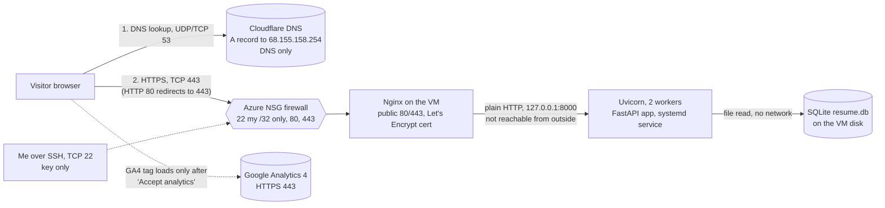
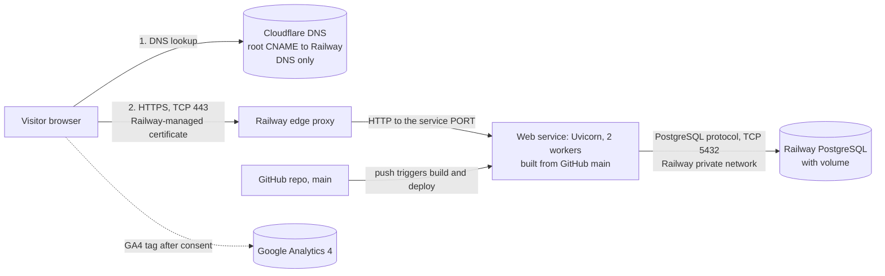
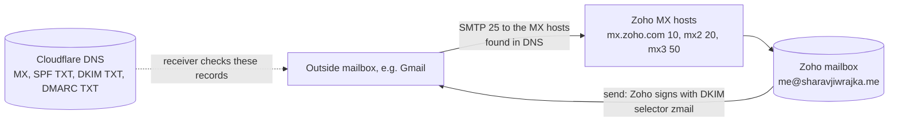

# Architecture diagrams

Both diagrams use Mermaid, which GitHub renders in the browser. Domain: `sharavjiwrajka.me`. DNS provider: Cloudflare (DNS only for records that reach my own server).

## Azure (original deployment, kept running as evidence and as the rollback target)

## Railway (target deployment)

## Email path (unchanged by the migration)

Email never touches the web server. Only DNS records matter.

## Analytics path

1. The visitor loads the page from Azure or Railway (HTML only, no Google code yet).
2. The visitor clicks **Accept analytics**. `static/analytics.js` then adds Google's `gtag.js`, using the public measurement ID from `data-ga-id`.
3. The browser sends events (`page_view`, outbound `click`) straight to Google over HTTPS. The web server and the database are not involved.
4. GA4 Realtime shows them. Evidence: `docs/evidence/ex06.md`.

## What lives where

| Piece | Azure | Railway |
| --- | --- | --- |
| Code | `git pull` on the VM | built from GitHub `main` |
| Database | SQLite file on the VM | managed PostgreSQL |
| TLS | Let's Encrypt via Certbot, renewed by `certbot.timer` | Railway-issued, renewed by Railway |
| DNS | Cloudflare | Cloudflare (same zone) |
| Email | Zoho (same) | Zoho (same) |
