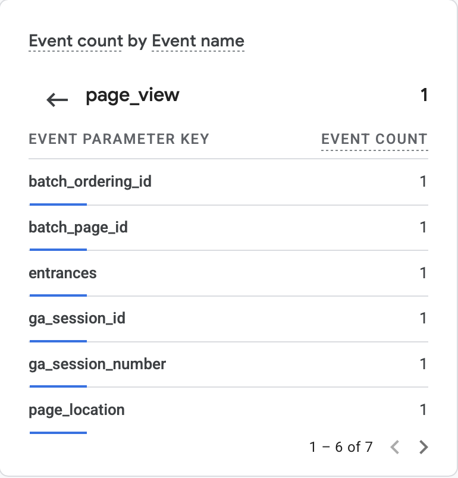
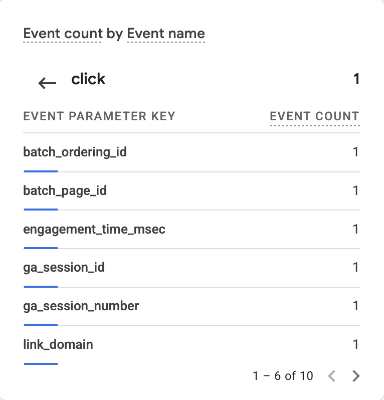
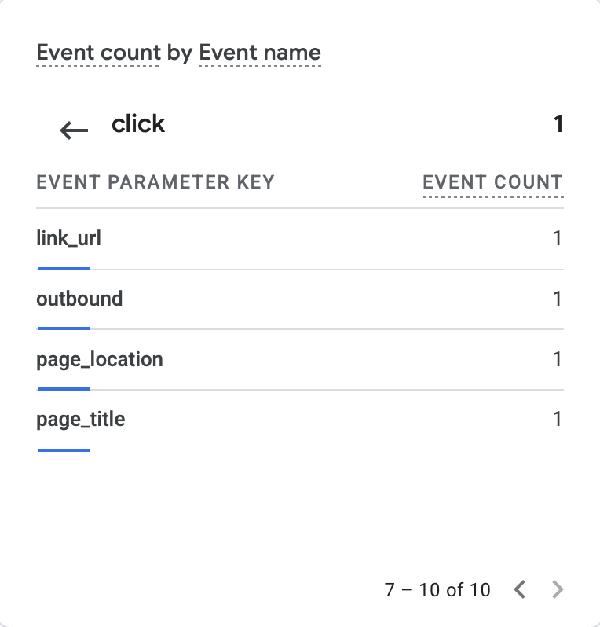

# Exercise 06 evidence: domain email and Google Analytics

Domain: `sharavjiwrajka.me`. DNS is on Cloudflare. Mail is on Zoho Mail's free plan. Live site: https://sharavjiwrajka.me

## 1. Email tests

All tests used my domain mailbox and an outside Gmail mailbox that I control. Times are Pacific, October 20, 2026. Message bodies and personal addresses are left out on purpose.

| Test | Subject | Time | Result |
|---|---|---|---|
| Received | `Test 01: inbound` (outside Gmail to my domain address) | 3:46 AM | Arrived in the Zoho inbox the same minute. |
| Replied | `Re: Test 01: inbound` (Zoho to outside Gmail) | 3:47 AM | Arrived in the outside Gmail inbox, not spam. |
| Sent a new message | `Test 02: new outbound` (Zoho to outside Gmail) | 3:48 AM | Arrived in the outside Gmail inbox. From shows my `sharavjiwrajka.me` address. |

How the tests were run: Test 01 was sent from Gmail. The reply and Test 02 were sent from Zoho webmail. I confirmed the reply and Test 02 on the Gmail side by reading them there, not just from Zoho's Sent folder.

Mail records I added in Cloudflare, next to the existing website records (the two A records for `@` and `www` were not changed):

- Three MX records for Zoho (`mx.zoho.com` 10, `mx2.zoho.com` 20, `mx3.zoho.com` 50), plus the Zoho ownership TXT. These were already in place.
- SPF TXT at `@`: `v=spf1 include:zohomail.com ~all`
- DKIM TXT at `zmail._domainkey`, using the key Zoho generated.
- DMARC TXT at `_dmarc`: `v=DMARC1; p=none; rua=mailto:<my domain address>`. This is monitor only.

After saving them, Zoho's admin console showed "DKIM selector is successfully verified" and "Your domain's SPF Records have been pointed successfully". Zoho's own checks confirm the setup. They do not prove a particular message passed, so the next section uses the receiving mailbox.

## 2. SPF, DKIM, and DMARC results

Source: the raw header of `Test 02: new outbound` as received by the outside Gmail mailbox. These are Gmail's own verdicts on that message. The local part of my mailbox address is redacted.

```text
Authentication-Results: mx.google.com;
       dkim=pass header.i=@sharavjiwrajka.me header.s=zmail header.b=JaWe4Tmp;
       spf=pass (google.com: domain of <mailbox>@sharavjiwrajka.me designates 165.173.182.52 as permitted sender) smtp.mailfrom=<mailbox>@sharavjiwrajka.me;
       dmarc=pass (p=NONE sp=NONE dis=NONE) header.from=sharavjiwrajka.me
```

What it says: SPF passed for the Zoho sending IP, DKIM passed with the `zmail` selector for my domain, and DMARC passed because the passing domain matches the From domain. The policy is `p=NONE`, as I set it, so DMARC only reports and does not reject.

## 3. Google Analytics 4

Live site: https://sharavjiwrajka.me
Privacy page: https://sharavjiwrajka.me/privacy

The Privacy page is linked from the site footer. The Google tag (Measurement ID `G-P3X3HRX152`) is not loaded until a visitor clicks "Accept analytics" on the banner. "Decline" keeps it off, and "Privacy choices" in the footer lets a visitor change the choice later. Because of this, View Page Source shows the ID in a `data-ga-id` attribute, and the Google script is added only after Accept.

What I checked in GA4, Reports > Realtime, on October 20, 2026 after accepting the banner on the live site and then clicking the LinkedIn link:

| Event | Seen in Realtime | Notes |
|---|---|---|
| `page_view` | Yes, 1 | Page title "Sharav Jiwrajka" |
| `click` | Yes, 1 | Parameters listed: `link_url`, `link_domain`, `outbound`, plus `page_location`, `page_title` and session fields |
| `first_visit`, `session_start` | Yes | Created automatically |

Screenshots (GA4 Realtime, parameters of each event):

- `page_view`: [ex06-page-view.png](ex06-page-view.png)
- `click`, first page of parameters, including `link_domain`: [ex06-click.png](ex06-click.png)
- `click`, second page of parameters, including `link_url` and `outbound`: [ex06-click-details.png](ex06-click-details.png)





I used Claude to help run the email tests and organize this record. I checked each result against what I saw in Zoho and Gmail.
