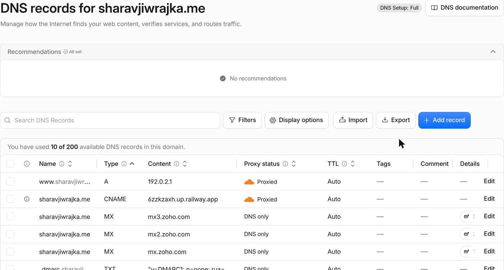
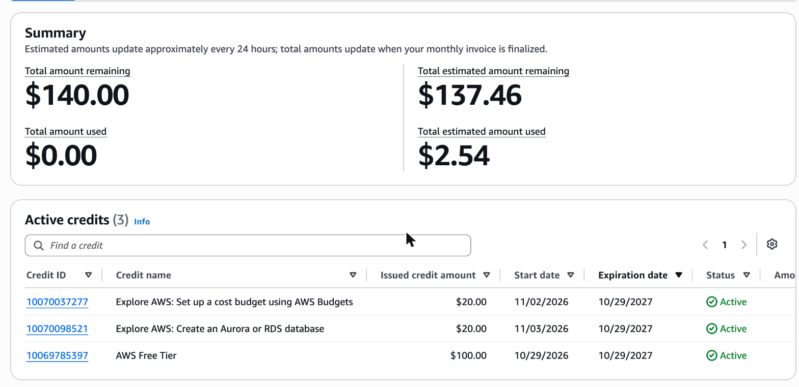

# Exercise 07 evidence: moving the site from Railway to AWS

Status on 2026-11-09 (Pacific): **not finished.** The database is built and checked. The server could not be launched because my AWS account's EC2 vCPU quota is 1, so nothing could be deployed, restored onto RDS or tested on a subdomain, and the domain has not moved. The Railway trial has ended, so `sharavjiwrajka.me` is offline until AWS is ready. This sheet says what I did, what I checked, and what is left.

Plan: [2026-11-03-aws-migration.md](../superpowers/plans/2026-11-03-aws-migration.md). Running log: [migration-notes.md](../migration-notes.md). Diagram: [README, AWS migration](../../README.md#aws-migration-in-progress).

## 1. Architecture decision

I chose EC2 for the app with a Single-AZ RDS PostgreSQL database over running PostgreSQL on the same server and over Lambda with API Gateway, because I wanted AWS to run the database and its backups without changing the app, and I accept about $12 a month for the database, one more service to secure, and that Single-AZ means the site is down if zone us-east-1a has an outage.

## 2. Backup record

| Item | Record |
| --- | --- |
| Backup date | 2026-11-02 |
| What was backed up | The Railway PostgreSQL 18.6 database, exported in `pg_dump` custom format (16 KB) through the Railway CLI tunnel, so the database was never exposed publicly. The site has no uploads |
| Restore test | Restored into a new local PostgreSQL 18 database. All ten table row counts matched the counts taken from Railway (table below) |
| Independent copies | The laptop, and iCloud Drive with a matching SHA-256 |
| Data loss I accepted (RPO) | 24 hours. The site has no write path, so the data only changes when I change it |
| Recovery time I accepted (RTO) | 4 hours |
| RDS automated backups | 7 days, set on 2026-11-09. They were 1 day from 2026-11-03 until I upgraded the account plan, because the Free plan caps retention at 1 day |
| Restore onto RDS | **Not done.** RDS is private, so the restore has to run from the EC2 instance, which could not be launched |

Row counts from Railway and the local restore (matching):

| Table | Rows |
| --- | --- |
| certifications | 0 |
| education | 2 |
| experience_achievements | 33 |
| experiences | 11 |
| profile_links | 3 |
| profiles | 1 |
| project_links | 1 |
| projects | 1 |
| skill_groups | 0 |
| skills | 0 |

## 3. Verification

### 3a. The test subdomain (aws.sharavjiwrajka.me)

I did not create the subdomain, because there is no server to point it at. Nothing below was tested.

| What I would test | Evidence | Result |
| --- | --- | --- |
| A record for `aws` points at the Elastic IP, DNS only | None, no Elastic IP exists | Not verified |
| Valid HTTPS certificate and padlock | None | Not verified |
| `/health` returns 200 | None | Not verified |
| Home page content matches the Railway and Azure pages | None | Not verified |
| Row counts on RDS match the ten counts above | None, the restore has not run | Not verified |
| App connects as the read-only user and cannot write | None | Not verified |
| Service comes back after a restart and a reboot | None | Not verified |
| Port 5432 is not reachable from the internet | See 3b, the database is configured as not publicly accessible. I did not probe the port | Not verified |

### 3b. What I did check on 2026-11-09

These are AWS CLI results from my laptop, signed in as a non-root IAM user.

| Check | Evidence | Result |
| --- | --- | --- |
| RDS database exists and is running | `describe-db-instances`: `career-platform-db`, db.t4g.micro, status available, postgres 18.6 | Pass |
| Not publicly accessible | `PubliclyAccessible` is False | Pass |
| Single-AZ, in the planned zone | `MultiAZ` False, zone us-east-1a | Pass |
| Encrypted, 20 GB gp3 | `StorageEncrypted` True, 20, gp3 | Pass |
| 7-day automated backups | `modify-db-instance` returned 7 after the plan upgrade | Pass |
| Database firewall allows port 5432 only from the web security group | Recorded in migration-notes on 2026-11-03. I did not re-run it today | Not verified today |
| Ubuntu 26.04 image published by Canonical | `describe-images` with Canonical's owner ID returned `ubuntu-resolute-26.04-amd64-server-20261104.1`, amd64 | Pass |
| SSH allowed from my current network only | `authorize-security-group-ingress` for one /32 address returned `Return: true` | Pass |
| Launch one t3.micro | `run-instances` failed with `VcpuLimitExceeded`, limit 1 | **Fail** |

### What I tried, what happened, and my next step

- **Tried:** I launched an instance on 2026-11-02 (a t3.small) and again on 2026-11-09 (a t3.micro, which is the size the guide uses). Both failed with `VcpuLimitExceeded`. Service Quotas shows the applied quota for the Standard instance family as 1 vCPU, against an AWS default of 5, and every t3 size needs 2.
- **What happened next:** AWS denied my quota increase request on 2026-11-02 (support case 179367074500312). I sent an appeal the same evening and had no reply by 2026-11-09. My instructor advised that I might need a paid plan, so I upgraded from the Free plan to the Paid plan on 2026-11-09, retried the launch (same error), and added an update to the open case. Service Quotas will not accept a new request while the first one is open.
- **Next step:** when AWS raises the quota to 2 or more, I run the launch command I have prepared (t3.micro, Ubuntu 26.04, IMDSv2 required, 20 GB encrypted disk) and continue with sections 4 to 8 of the plan.

## 4. Cutover status

**Not cut over.** On 2026-11-09 the Railway dashboard showed "Trial Ended" with 0 of 2 services online, and `https://sharavjiwrajka.me` returned Railway's own 404 page. So the domain still points at Railway, and the site is down.

Screenshot of the DNS records, taken 2026-11-09 from Cloudflare. The root record `sharavjiwrajka.me` is still a CNAME to Railway (`...up.railway.app`), and `www` is still a placeholder A record (`192.0.2.1`), both proxied. Neither points at AWS yet.

What is left, in order:

1. AWS approves the vCPU quota (support case open).
2. Launch the instance and attach an Elastic IP.
3. On the instance: install Nginx, Python and the PostgreSQL 18 client, restore the 2026-11-02 dump onto RDS with `pg_restore --no-owner --no-acl`, and compare the ten row counts above.
4. Create the read-only database user for the app.
5. Deploy the app behind Nginx as a systemd service.
6. Test it on `aws.sharavjiwrajka.me` and fill in the table in 3a.
7. Point the root and `www` records at the Elastic IP, DNS only (grey cloud), and check with `nslookup` and the padlock.

**When:** I start the day AWS approves the quota, and I expect the cutover within a day after that. The rollback target is the Azure VM, which was still running on 2026-11-03. I have not re-checked it since.

## 5. Cost

- **Estimate:** about $26.82 a month before credits (EC2 t3.micro $7.59, EBS $1.60, RDS $11.68, RDS storage $2.30, public IPv4 $3.65). Prices come from AWS's public price list for us-east-1, 730 hours a month. Details: [plan, Cost section](../superpowers/plans/2026-11-03-aws-migration.md).
- **Billing page now (2026-11-09):** the screenshot shows $140.00 in credits ($100 Free Tier credit plus two $20 activity credits), an estimated $2.54 used, and an estimated $137.46 left. All three expire 2027-10-29. Only the RDS database has run so far, which fits that small amount.
- **Account plan:** upgraded from Free to Paid on 2026-11-09 on my instructor's advice. The credits carry over, so I expect to pay nothing out of pocket. At the estimate, the credits last about five months. I will stop or delete the resources and release the Elastic IP at the end of the course so nothing keeps billing.

